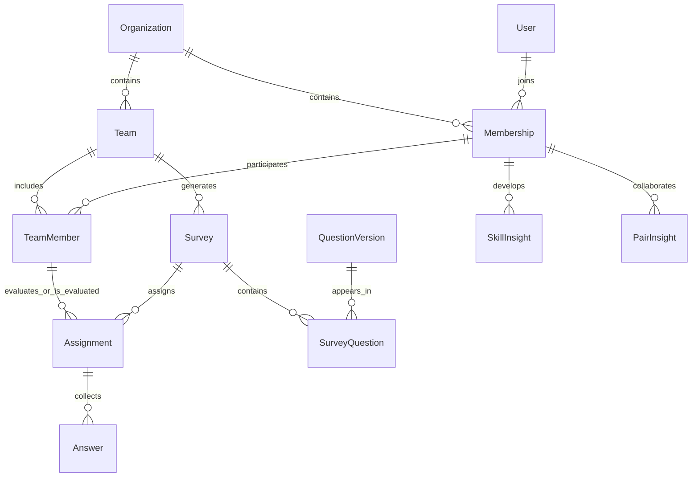

# Database design, first iteration

## Lasting identities, temporary teams

An Organization is the company boundary. A User is a login identity; a Membership is their employee identity and organization role within one company. A user can have memberships in multiple companies; scores never cross companies.

A Team is a feedback context, optionally ending at a known date. TeamMember records participation intervals. People may participate in overlapping teams, leave, and return. TeamAccess separately grants a manager or team leader responsibility for a team; access does not itself imply participation.

## Feedback and derived insights

The first question type is a 1–5 rating, with nullable ratings explicitly representing unobserved behaviour. Null ratings supply no numerical evidence. QuestionVersion preserves historical wording, author and HR approval metadata. Only approved versions can enter a survey; previous versions are preserved as legacy approvals. See [question approval](questions.md). QuestionSkill maps skill questions to weighted skills. QuestionDimension separates skill evidence, chemistry enjoyment, chemistry effectiveness and older unspecified questions; it is immutable for each question version. Chemistry questions cannot have skill mappings. SurveyQuestion freezes which question versions belong to a survey. Assignment identifies the respondent, subject and original team context; Answer stores the evidence.

Submitted answers and assignments are protected against edits; incomplete submissions are rejected. A question's wording cannot change after it is assigned to a survey. Survey composition, skill mappings and context are now frozen by database triggers after issuance. The survey API enforces open periods, scoped assignment ownership, eligibility and complete atomic submission. FeedbackPolicy versions preserve current and pending calendar settings and explicit automation opt-in. SurveyGeneration records one durable receipt per company/cycle so retries do not duplicate requests or top up blocked batches. Periodic deadlines are null; old deadlines are archived in legacyClosesAt.

SkillInsight belongs to an employee membership, independent of teams. PairInsight belongs to two employee memberships in canonical UUID order, independent of teams, and retains combined and directional values. It stores model version, evidence count, confidence and computation time. No chemistry algorithm or evaluator weights are implemented. Missing scores are null; zero confidence represents insufficient evidence. The numerical test values are synthetic fixtures, not a proposed scoring formula.

Assignment outcomes and linear replacement history preserve the difference between completion, voluntary skip, replacement and insufficient opportunity. ParticipationCredit stores immutable 100%/60% entries, one per original assignment slot; it does not assign a point value.

Raw feedback stays separate from recalculable summaries. Aging, baseline calibration, weighting, confidence thresholds and retention remain open. Never equate a high score with productivity or treat evidence volume as a high score.

## Visibility contract

| Viewer | Intended access |
| --- | --- |
| Employee | Own development insights and own reported collaboration experience |
| Team leader / manager | Combined and directional insights between other people in authorized teams, including relevant past evidence |
| Leader / manager involved in the pair | Ordinary employee view of that relationship |
| Independent HR administrator | Organization-wide interpreted insights; access to raw responses and numbers remains undecided |
| Company owner | Account administration; this role alone does not imply access to all feedback |

Ownership, administrative authority and personal participation must not be used to bypass the relationship restriction. Independence of the HR administrator must be enforced before granting unrestricted insight access; its precise eligibility rules remain to be specified.

The browser must receive permitted qualitative indicators, not serialized persistence models. Numerical survey inputs and participation-point amounts are distinct from hidden analytical scores.

Composite foreign keys reject cross-company links and enforce that assignment participants come from the same team as the survey. These integrity checks are **not** read authorization. The company/team API now implements session authentication, tenant-scoped queries and administrative/team role checks. Its build and HTTP tests pass; see api.md. Analytics endpoints and their relationship-level visibility rules have not been implemented. Use fictional data only.

## Deliberately deferred

Hosted identity-provider integration, email delivery/recovery, interaction confirmation beyond self-reporting, company point conversion and the reward store, audit and retention workflows, qualitative thresholds, and chemistry calculations. No five-skill cap or evaluator multiplier has been hard-coded.

The company/team and survey collection workflows are implemented. Next product decisions include participation rewards, interaction confirmation and the chemistry model. Frontend design remains a joint activity with the product owner.
